## Gali Ün

**ai engineer** · istanbul, open to relocation or remote · [galinilin.com](https://galinilin.com)

machine learning since 2017, full-stack since 2019, **self-taught**. i aim to bridge the gap between what ai can do in theory and what it should do for us **in practice**.

i see ai not as a product for the few, but as a **collective achievement** that should work like a **universal utility**.

### projects

<table>
<tr>
<td width="33%" valign="top"> <b><a href="https://galinilin.com/work/deepvariant/">DeepVariant in your browser</a></b> 2026 Google's variant caller, 22 MB, running in a browser tab.</td>
<td width="33%" valign="top"> <b><a href="https://galinilin.com/work/docgemma/">DocGemma</a></b> 2026 A clinical AI agent that asks a human before every action.</td>
<td width="33%" valign="top"> <b><a href="https://galinilin.com/work/artificialneural-network/">artificialneural.network</a></b> 2021 Build a neural network and watch it learn, in the browser.</td>
</tr>
<tr>
<td width="33%" valign="top"> <b><a href="https://galinilin.com/work/teknofest-2018/">Teknofest 2018</a></b> 2018 A small seq2seq language model with attention. 3rd place.</td>
<td width="33%" valign="top"> <b><a href="https://galinilin.com/work/caelum/">Caelum 3D Engine</a></b> 2019 From scratch: lights, shadow maps, skeletal animation, FBX models.</td>
<td width="33%" valign="top"> <b><a href="https://galinilin.com/work/bipedalwalker-a3c/">BipedalWalker, A3C</a></b> 2019 A two-legged walker learns to walk. 4 workers, ~21 hours on one CPU.</td>
</tr>
</table>

### writing

<!-- BLOG-POST-LIST:START -->

- [Looking Through DeepVariant's Eyes- But In Your Browser](https://galinilin.substack.com/p/looking-through-deepvariants-eyes)
- [Code already has structure, why are we throwing that away?](https://galinilin.substack.com/p/code-already-has-structure-why-are)
- [As We Move Towards Agentic AI: RAG, MCP, Test-time compute and all that](https://galinilin.substack.com/p/as-we-move-towards-agentic-ai-rag)
- [Genetik mi Algoritmalar?  #2: DEAP!](https://medium.com/rsparametrelerbutunu/genetik-mi-algoritmalar-2-deap-faaaaab756f7?source=rss-873ea545dd09------2)
- [Genetik mi Algoritmalar?  #1: Evet.](https://medium.com/rsparametrelerbutunu/genetik-mi-algoritmalar-1-evet-9fded872060b?source=rss-873ea545dd09------2)
<!-- BLOG-POST-LIST:END -->

<!-- Commit counter -->

  
  

<!-- View counter -->

  

